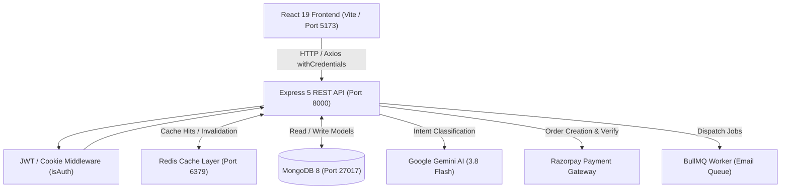

# InstructoPlus 🎓⚡

A modern, production-grade **Full-Stack Learning Management System (LMS)** built with **React 19, Express 5, and MongoDB**. Designed as a two-sided marketplace connecting passionate educators and active learners with video streaming, automated course progress tracking, Google Gemini AI natural language search, cryptographic Razorpay payment verification, Redis in-memory caching, and BullMQ background queues.

---

## 🌟 Key Highlights & Engineering Features

- 🔍 **AI-Powered Semantic Course Search**: Integrated **Google Gemini AI (`gemini-3.8-flash`)** to process conversational search queries (e.g. *"I want to build mobile apps"*), extracting student intent into relevant category keywords with instant MongoDB fallback.
- 💳 **Cryptographic Payment Gateway**: Complete **Razorpay** integration with server-side HMAC-SHA256 signature verification, instant course enrollment unlock, and a built-in mock fallback for offline/development testing.
- ⚡ **Redis In-Memory Caching**: Heavy course catalog and search queries cached with automated TTL and invalidation triggers on content mutations (~2ms–5ms cache hits).
- 📬 **BullMQ Asynchronous Job Processing**: Decoupled Nodemailer transactional emails into isolated background workers with exponential backoff retries, ensuring zero HTTP request blocking.
- 📊 **Granular Progress & Playback Tracking**: Student video playback timestamp resumption, per-lecture completion states, live course percentage indicators, and milestone feedback.
- 🛡️ **Role-Based Access Control (RBAC)**: Strict role boundaries (`student`, `educator`, `admin`) enforced at both database schema and Express JWT middleware levels with HttpOnly cookie protection.
- 🐳 **Dockerized Container Architecture**: Multi-stage production container builds (Node 20 Alpine & Nginx SPA reverse proxy) orchestrating MongoDB, Redis, Backend, and Frontend via Docker Compose.
- 🧪 **Automated Testing Suite**: Full Selenium end-to-end browser testing script (`run_selenium_tests.py`) covering all 23 views across guest, student, and educator roles.

---

## 🛠️ Tech Stack

| Layer | Technologies |
|---|---|
| **Frontend** | React 19, Vite, Redux Toolkit, Tailwind CSS, React Router v7, Framer Motion, Axios, React Icons |
| **Backend** | Node.js (ESM), Express 5, MongoDB, Mongoose 8, JWT, bcryptjs, Multer |
| **AI / LLM** | Google Gemini API (`@google/genai` with `gemini-3.8-flash`) |
| **Payments** | Razorpay SDK (Order creation & HMAC-SHA256 signature verification) |
| **Caching & Queues** | Redis 7.2, ioredis, BullMQ (Background Workers & Job Schedulers) |
| **Media & Emails** | Cloudinary (CDN storage), Nodemailer (SMTP password recovery) |
| **Testing & QA** | Selenium WebDriver (Python), Automated Backend Test Suite (`test_suite.mjs`) |
| **DevOps** | Docker, Docker Compose, Nginx |

---

## 🏛️ System Architecture



---

## 🚀 Getting Started

### Prerequisites
- **Node.js** (v18 or higher)
- **MongoDB** (Local Community Server running on `127.0.0.1:27017` or MongoDB Atlas URI)
- **Git**

---

### Method 1: Local Development (Recommended)

#### 1. Clone the repository
```bash
git clone https://github.com/devTanmayBang2104/InstructoPlus.git
cd InstructoPlus
```

#### 2. Backend Setup
```bash
cd backend
npm install
```

Create a `.env` file inside `backend/` (refer to `backend/.env.example`):
```env
PORT=8000
MONGODB_URL=mongodb://127.0.0.1:27017/instructoplus
JWT_SECRET=your_jwt_secret_key_here
GEMINI_API_KEY=your_gemini_api_key_here
RAZORPAY_KEY_ID=your_razorpay_key_id
RAZORPAY_KEY_SECRET=your_razorpay_key_secret
```

Start the backend:
```bash
npm run dev
# Server will run on http://localhost:8000
```

#### 3. Frontend Setup
In a new terminal:
```bash
cd frontend
npm install
npm run dev
# Application will run on http://localhost:5173
```

---

### Method 2: Docker Compose (All-in-One)

Run the full stack (Frontend, Backend, Redis, MongoDB) with a single command:
```bash
docker compose up --build
```
- **Frontend Web App**: http://localhost:5173 (or http://localhost:80)
- **Backend API**: http://localhost:8000
- **Redis Cache & Queue**: localhost:6379
- **MongoDB**: localhost:27017

---

## 🔑 Demo Credentials

To test the application immediately without signing up:

| Role | Email | Password | Access & Capabilities |
|---|---|---|---|
| **Student** | `student@local.com` | `Password@123` | Browse catalog, stream video lectures, test Razorpay checkout, search with Gemini AI |
| **Educator** | `educator@local.com` | `Password@123` | Analytics dashboard, course editor, lecture video uploader, student roster, announcements |

---

## 🧪 Testing

### 1. Backend Test Suite
Runs all 23 unit, integration, and architecture tests:
```bash
cd backend
node test_suite.mjs
```

### 2. End-to-End Selenium Test Suite
Automates authentication and captures high-resolution screenshots of all 23 public, student, and educator views:
```bash
python run_selenium_tests.py
```

---

## 📂 Project Structure

```
InstructoPlus/
├── backend/
│   ├── config/             # DB connection, Cloudinary, Redis, Nodemailer
│   ├── controller/         # Business logic (Auth, Courses, Orders, AI Search)
│   ├── middleware/         # Auth guards, Rate limiters, RBAC, Caching
│   ├── model/              # Mongoose schemas (User, Course, Lecture, Progress)
│   ├── queue/              # BullMQ email queue and background worker
│   ├── routes/             # REST route endpoints
│   ├── index.js            # Express server entry point
│   └── .env.example        # Environment variable template
│
├── frontend/
│   ├── src/
│   │   ├── components/     # Reusable UI components (Nav, Footer, Cards)
│   │   ├── customHooks/    # Auto-fetchers (getCurrentUser, getCreatorCourse)
│   │   ├── pages/          # Student & Public screen views
│   │   │   └── Educator/   # Instructor management dashboard views
│   │   ├── redux/          # Redux Toolkit global store slices
│   │   ├── App.jsx         # Route map & protected route guards
│   │   └── main.jsx        # React root provider setup
│   └── vite.config.js      # Vite build configuration
│
├── docker-compose.yml       # Multi-container orchestration
└── run_selenium_tests.py    # Automated E2E testing suite
```

---

## 📄 License

This project is licensed under the [MIT License](LICENSE).
